# CrimsonWeb — Faz 4A: Scope & Workspace Foundation

Tarih: 9 Ekim 2026 (Europe/Istanbul). Kapsam: workspace ve izin altyapısı.
4B crawler, 4C zafiyet testleri, 4D–4E modülleri veya dashboard geliştirilmedi.

## Mevcut durum ve uyumluluk

README, Faz 3/3.5 belgeleri, `MODEL_BENCHMARK.md`, SQLAlchemy repository,
Alembic, API kimlik doğrulaması, Scope, ScanEngine ve testler incelendi.
Başlangıçta **235 standart test geçti; 3 opt-in Ollama testi atlandı** (14,11 s).
Gemma 4 optimize profilindeki üç gerçek test başlangıçta ayrıca geçti (126,40 s).
Önceden bulunan Git değişiklikleri ve izlenmeyen faz dosyaları korundu.

CLI kodu değiştirilmedi. Eski `/scans`, `/history`, WAF ve AI endpoint sözleşmeleri
korundu. OllamaProvider, dinamik JSON Schema, kanıt referansı doğrulaması,
Türkçe çıktı doğrulaması ve AI güvenlik kontrolleri değiştirilmedi.
`Scope.parse_url()` ortak URL doğrulamasını kullanıma açar; eski `Scope.validate_url()`
aynı host allowlist ve IP denetimini sürdürür. ScanEngine'in mevcut analizleri
yeniden yazılmadı; yalnız istek açma bölümü isteğe bağlı workspace guard kullanabilir.
Eski ve yeni yollar IP sabitleme, Host/SNI ve proxy/redirect ayarları için aynı
`pinned_response()` yordamını kullanır; bu yordam izin kararı vermez.

## Mimari

`workspaces/models.py` sınırlı Pydantic sözleşmelerini, `policy.py` saf Python
kararlarını, `dns.py` resolver arayüzünü, `store.py` mevcut Repository motoru
üzerindeki işlemleri, `service.py` ortak izin/istek arayüzünü ve `routes.py`
sürümlü API'yi içerir. LLM, kapsam kararına katılmaz ve bu servis için araç veya
kimlik bilgisi almaz. Yerel Ollama erişimi mevcut ayrı sağlayıcı güvenlik sınırını kullanır.

```mermaid
flowchart TD
    A[Operatör API kimlik doğrulaması] --> B[Workspace ve politika yönetimi]
    C[WorkspaceService.stream / ScanEngine guard] --> D[Workspace ve izin ön kontrolü]
    D --> E[Taze A / AAAA ve CNAME doğrulaması]
    E --> F[SQLite BEGIN IMMEDIATE: tekrar kontrol ve rezervasyon]
    F --> G[Doğrulanmış IP'ye HTTP bağlantısı; Host ve TLS SNI korunur]
    G --> H[Yanıt kapanır; slot bırakılır; audit saklanır]
    G --> I[403 / 429: politika kalıcı olarak durdurulur]
```



Yeni tablolar:

| Tablo | İşlev |
|---|---|
| `workspaces` | UUID, isim, açıklama, program türü, aktiflik ve UTC oluşturma/güncelleme zamanı |
| `program_policies` | Workspace başına tek güncel politika, revizyon, tüketilmiş bütçe ve durdurma nedeni |
| `target_scopes` | Politikanın domain, CIDR, yol, method, port ve kategori kapsamı |
| `policy_revisions` | Güncellemelerden önceki kapsamların ayrı, API üzerinden salt okunur kayıtları |
| `scope_audit_logs` | Workspace/politika/revizyon, zaman, işlem, karar, neden, URL özeti ve doğrulanmış IP'ler |
| `scope_request_leases` | Aktif slotlar ve kayan 60 saniyelik hız sınırı için kalıcı rezervasyonlar |

Politika, hedef kapsamı, revizyon ve lease/audit sorguları workspace kimliğini
de kullanır. Bir workspace yoluna başka workspace'in politika UUID'sini vermek
serviste ve API'de bulunamadı sonucuna gider. Bileşik foreign key'ler bu ilişkiyi
SQLite seviyesinde de korur. Workspace/politika/audit kaydı silme API'si yoktur.

## Politika ve güvenlik garantileri

- Yeni politika **deny-by-default**: boş izin listeleri, sıfır bütçe, onaysız
  operatör veya bitiş tarihi olmayan taslak hiçbir aktif isteğe izin vermez.
- Program türleri: `owned`, `authorized_pentest`, `bug_bounty`, `lab`.
  Onay için `operator_approved=true`, `approved_by` ve `scope_source` gerekir.
  Bu alanlar yetkili operatörün beyanıdır; program sahibinin iznini dışarıdan doğrulamaz.
- Domain hedefinde hem domain hem bütün DNS IP'leri izinli olmalıdır. IP literal
  hedefleri CIDR üzerinden değerlendirilir. `*.example.test` alt alanları kapsar;
  `example.test` için ayrı kural gerekir. Kısmi/orta wildcard, salt TLD wildcard,
  hatalı CIDR ve host bitleri bulunan CIDR reddedilir. IDNA'nın ASCII biçimi kullanılır.
- Tam yol veya terminal `/*` kuralları vardır. `/admin/*`, `/admin` ve alt yollarını
  kapsar; `/administrator` eşleşmez. Yasak yollar ve kategoriler izinlerden önce gelir.
  HTTP method, kategori ve port açık allowlist içindedir.
- HTTP(S) dışında şema, URL içinde credentials/query/fragment, kontrol karakteri,
  backslash ve belirsiz percent/dot-segment yolları kabul edilmez. Query ve encoded
  path desteği bu aşamada bilinçli olarak kapalıdır.
- Geçerlilik ve test penceresi saat dilimli datetime kullanır; başlangıç dahil,
  bitiş hariçtir. DNS beklerken politika/aktiflik/zaman değişirse SQLite rezervasyonu
  sırasında tekrar değerlendirilir. Revizyon değişimi `policy_changed` ile reddedilir.
- Her gerçek istek yeni DNS kontrolünden geçer. A ve AAAA yanıtlarının CNAME zinciri
  tutarlı olmalı; her alias açık domain kapsamına uymalıdır. Zincir en çok sekiz
  alias olabilir. DNAME ve belirsiz/eksik DNS yanıtları güvenli şekilde reddedilir.
- Bağlantı DNS'ten dönen doğrulanmış IP'ye sabitlenir. Host ve TLS SNI özgün izinli
  hostname'i kullanır. Yeniden DNS çözümleyerek başka IP'ye bağlanılmaz; alternatif
  IP denemesi, proxy, otomatik redirect veya otomatik retry yoktur.
- Loopback/private erişim yalnız `owned`/`lab`, açık `allow_private_networks=true`
  ve izinli CIDR birlikte olduğunda mümkündür. Bug bounty/pentest workspace'leri
  private veya diğer global olmayan adreslere bağlanamaz. Unspecified, multicast,
  link-local, ayrılmış adresler ve IPv4-mapped/6to4/Teredo IPv6 geçişleri reddedilir.
  Loopback, açık laboratuvar izni için ayrılmış-adres kuralının sınırlı istisnasıdır.
- Link-local metadata adresleri ile `100.100.100.200`, `168.63.129.16` ve
  `fd00:ec2::254` aktif HTTP hedefi olarak her durumda reddedilir. Bu adreslerin
  platform/metadata rolleri [Alibaba belgelerinde](https://www.alibabacloud.com/help/en/ens/instance-metadata),
  [Microsoft belgelerinde](https://learn.microsoft.com/en-us/azure/virtual-network/what-is-ip-address-168-63-129-16)
  ve [AWS belgelerinde](https://docs.aws.amazon.com/AWSEC2/latest/UserGuide/instancedata-data-retrieval.html)
  açıklanır. Resolver'ın yapılandırılmış DNS altyapısına yaptığı sorgular HTTP hedef isteği değildir.
- `maximum_request_budget`, `maximum_concurrency`, `rate_limit_per_minute`
  aynı SQLite yazma kilidi altında uygulanır. Ayrı Repository bağlantıları arasında
  da atomiktir. Her redirect ayrı rezervasyon tüketir. Bağlantı hatası ve iptal
  tüketilen bütçeyi geri vermez. Politika güncellemesi de bütçeyi sıfırlamaz.
- Slot, HTTP yanıtı kapanana kadar tutulur. Normal hata ve iptal slotu bırakır;
  veritabanı rezervasyonu sürerken iptal gelirse thread işleminin sonucu alınarak
  slot temizlenir. Policy güncellemesi açık slotları sıfırlamaz.
- 403/429 politikayı yanıt tüketiciye verilmeden kalıcı durdurur. Güvenilir WAF/IDS
  katmanı `notify_defense(..., 'waf_block'|'ip_block'|'authorization_violation')`
  çağırabilir. Sonraki istek/redirect reddedilir. Scope ihlalinde gönderim yapılmaz,
  audit yazılır ve aktif istek yolunda politika durdurulur. Preflight reddi tek
  başına politikayı durdurmaz. İzin sınırına takılınca bekleyip yeniden deneme yoktur.
- Devam etmek açık operatör politika güncellemesi gerektirir. Bu işlem yeni revizyon
  oluşturur ve durdurma nedenini kaldırır; diğer kapsam, zaman, bütçe ve slot kontrolleri sürer.
- Audit URL, query, credentials, cookie, token, oturum veya HTTP gövdesi saklamaz.
  Method/kategori/URL'nin SHA-256 özeti, karar kodları, kimlikler ve izinli IP kanıtı
  saklanır. Hash, URL'nin özgün metnini geri döndüren bir kayıt değildir.

`dnspython>=2.6,<3`, tam CNAME zincirini denetlemek için API extra'sına eklenen
tek bağımlılıktır. Resolver OS DNS yapılandırmasını kullanır; yerel cache kapalıdır,
search suffix kapalıdır ve çözümleme beş saniye ile sınırlıdır.
[Resolver belgeleri](https://dnspython.readthedocs.io/en/latest/resolver-class.html)
ve [async resolver belgeleri](https://dnspython.readthedocs.io/en/latest/async-resolver-class.html)
kullanılan DNS sözleşmesini açıklar.

## API

Bütün yollar mevcut FastAPI `authorize` bağımlılığını kullanır. Token tanımlıysa
Bearer zorunludur; tokensız erişim yalnız gerçek loopback istemcilere açıktır.
Workspace ID ve politika ID UUID olarak doğrulanır. Yeni sözleşmeler bilinmeyen
alanları reddeder. Sayfalar `items`, `total`, `limit`, `offset` döndürür;
`limit=1..100`, `offset=0..1000000`.

Tabloda `W=/api/v1/workspaces`, `{w}` workspace UUID, `{p}` politika UUID'dir.

| Method | Yol | İşlem |
|---|---|---|
| POST | `W` | Workspace oluştur |
| GET | `W` | Workspace listele, sayfala |
| GET | `W/{w}` | Workspace oku |
| PATCH | `W/{w}` | İsim/açıklama/aktiflik değiştir; program türü sabittir |
| POST | `W/{w}/policies` | İlk politika ekle; workspace başına tek politika |
| GET | `W/{w}/policies/{p}` | Güncel politika ve sayaçları oku |
| PUT | `W/{w}/policies/{p}?expected_revision=N` | Tam politikayı yeni revizyon olarak yaz |
| GET | `W/{w}/policies/{p}/revisions/{n}` | Önceki politika kapsamını oku |
| POST | `W/{w}/policies/{p}/validate` | İzinlerin yürütmeye hazır olup olmadığını değerlendir |
| POST | `W/{w}/policies/{p}/preflight` | URL/method/kategori için DNS dahil ön kontrol |
| GET | `W/{w}/audit` | Yalnız bu workspace'in audit kayıtlarını sayfala |

Oluşturma `201`, şema/UUID hatası `422`, kimlik doğrulama `401/403`, workspace veya
politika bulunamaması `404`, politika tekrar oluşturma/eski revizyon `409`, DB hatası
`503` döndürür. DB ayrıntıları response'a taşınmaz. Geçerli preflight isteğinin
izin reddi `200` ve `allowed=false` ile döner; bu, kontrolün başarıyla çalıştığını gösterir.
Ön kontrol bütçe tüketmez ve hedefe HTTP göndermez. Başarılı sonuç daha sonraki
istek için geçerli bir izin token'ı değildir: `stream()` her şeyi yeniden doğrular.

## Kurulum ve migration

Proje kökünde PowerShell:

```powershell
.venv\Scripts\python.exe -m pip install -e '.[api,dev]'
$env:CRIMSON_DATABASE_URL = 'sqlite:///data/crimsonweb.sqlite'
.venv\Scripts\python.exe -m alembic -c alembic.ini upgrade head
.venv\Scripts\python.exe -m uvicorn crimsonweb.api.app:app --host 127.0.0.1 --port 8000
```

Yeni head `0003_phase4a`, önceki `0002_phase3` üzerindedir. Eski teknik/AI tabloları
değiştirilmez. API başlangıcı mevcut mekanizma ile migration'ı zaten uygular.
Rollback komutu:

```powershell
.venv\Scripts\python.exe -m alembic -c alembic.ini downgrade 0002_phase3
```

Rollback **yeni workspace/politika/revizyon/audit/lease verilerini siler**; teknik
tarama ve AI kayıtlarını korur. Upgrade/downgrade testleri geçici SQLite dosyalarında
yapıldı; kullanıcı veritabanında rollback çalıştırılmadı.

## Kontrollü laboratuvar örneği

Token'ı operatör ortamında tanımlayın; aşağıdaki kod token değerini yazdırmaz.
Preflight örneği hedefte HTTP servisi olmasını gerektirmez ve HTTP isteği göndermez.

```powershell
$scopeBase = 'http://127.0.0.1:8000/api/v1/workspaces'
$scopeHeaders = @{ Authorization = "Bearer $env:CRIMSON_API_TOKEN" }
$scopeWorkspace = Invoke-RestMethod -Uri $scopeBase -Method Post -Headers $scopeHeaders -ContentType 'application/json' -Body (@{
  name = 'Yerel laboratuvar'; description = 'Bize ait izole HTTP laboratuvarı'; program_type = 'lab'
} | ConvertTo-Json)
$scopeBody = @{
  target_scope = @{
    allowed_domains = @(); allowed_networks = @('127.0.0.0/8')
    allowed_paths = @('/*'); forbidden_paths = @('/admin/*')
    allowed_methods = @('GET'); allowed_ports = @(8001)
    allowed_categories = @('web_observation'); forbidden_categories = @()
    allow_private_networks = $true
  }
  rate_limit_per_minute = 30; maximum_concurrency = 1; maximum_request_budget = 10
  valid_until = (Get-Date).ToUniversalTime().AddHours(1).ToString('o')
  operator_approved = $true; approved_by = 'lab-operator'; scope_source = 'Owned isolated lab, authorization LAB-001'
}
$scopePolicyUrl = "$scopeBase/$($scopeWorkspace.id)/policies"
$scopePolicy = Invoke-RestMethod -Uri $scopePolicyUrl -Method Post -Headers $scopeHeaders -ContentType 'application/json' -Body ($scopeBody | ConvertTo-Json -Depth 6)
Invoke-RestMethod -Uri "$scopePolicyUrl/$($scopePolicy.id)/preflight" -Method Post -Headers $scopeHeaders -ContentType 'application/json' -Body (@{
  url = 'http://127.0.0.1:8001/'; method = 'GET'; category = 'web_observation'
} | ConvertTo-Json)
Invoke-RestMethod -Uri "$scopeBase/$($scopeWorkspace.id)/audit" -Headers $scopeHeaders
```

Ortak Python arayüzü:

```python
from crimsonweb.api.engine import ScanEngine
from crimsonweb.api.scope import Scope
from crimsonweb.api.workspaces.models import AuthorizationRequest
from crimsonweb.api.workspaces.service import WorkspaceService

async def authorized_status(repository, workspace_id, policy_id):
    # Mevcut Repository; initialize() daha önce çağrılmış olmalı.
    service = WorkspaceService(repository)
    request = AuthorizationRequest(url="http://127.0.0.1:8001/", method="GET", category="web_observation")
    decision = await service.preflight(workspace_id, policy_id, request)
    # stream başarılı preflight'a dayanarak kontrolleri atlamaz.
    async with service.stream(workspace_id, policy_id, request) as response:
        return decision, response.status_code

async def authorized_scan(repository, workspace_id, policy_id, report):
    service = WorkspaceService(repository)
    guard = service.scan_guard(workspace_id, policy_id)
    scanner = ScanEngine(Scope(), interval=1, authorization=guard)
    await scanner.run(report)  # Her hop yeniden yetkilendirilir.
    return report
```

`report` mevcut `ScanReport` sözleşmesidir. Fonksiyonlar kendi async uygulama
akışınızdan çağrılır. 4A, yeni bir tarama türü oluşturmaz.

## Doğrulama sonuçları

| Kontrol | Sonuç |
|---|---|
| Başlangıç standart regresyon | 235 geçti, 3 gerçek test opt-in atlandı; 14,11 s |
| Son birleşik standart paket | **361 geçti, 3 opt-in atlandı; 18,43 s** |
| Yeni 4A senaryoları | 126 test; son pakette tümü geçti |
| Eski 235 test | Tümü son pakette geçti; migration head beklentisi `0003_phase4a` olarak güncellendi |
| Gerçek Gemma 4 başlangıç | Bulgu/tarama/WAF: 3 geçti; 126,40 s |
| Gerçek Gemma 4 ara tekrar | Bulgu/tarama/WAF: 3 geçti; 126,90 s |
| Son gerçek Gemma 4 tekrar | **Bulgu/tarama/WAF: 3 geçti; 96,81 s** |
| API + bütün faz/benchmark testleri için Ruff | Başarılı |
| `compileall -q src tests` | Başarılı |
| Bütün depo için Ruff | Başlangıç ve sonunda aynı 125 eski ihlal; bu alanın temiz olduğu iddia edilmiyor |

Son standart pakette başarısız test yoktur. Tek uyarı önceden bulunan Starlette
TestClient/httpx deprecation uyarısıdır. Geliştirme sırasında audit sıralaması
varsayımı ve sentetik DNS fixture'larının mutlak ad/wire indeks yapısı düzeltildi;
bu düzeltmeler için kapsam doğrulaması gevşetilmedi.

Testler kapsam dışı domain/IP, mixed DNS, preflight sonrası rebinding, redirect
sonrası rebinding, kapsam dışı redirect, CNAME zincirleri/DNAME/eksik DNS, yasak
yol/method/kategori, süre/pencere, DNS sırasında revizyon/aktiflik değişimi,
SSRF/private ağ ve platform endpoint reddi, bütçe, kayan rate limit, concurrency,
thread rezervasyonu sırasında iptal, WAF/403/429 durdurması, lease izolasyonu,
API Bearer denetimi, cross-workspace ID erişimi, SQLite foreign key'leri,
restart kalıcılığı, eski politika revizyonları ve veri koruyan migration'ı kapsar.
HTTP/DNS hedef testleri mock ve DNS wire biçiminde sentetik kayıtlarla yürütüldü;
üçüncü taraf hedeflerine tarama yapılmadı. Gerçek AI testleri yalnız yerel Ollama
ve sentetik teknik kayıtlardan oluşur.

Gerçek Gemma 4 profil komutu:

```powershell
$env:CRIMSON_TEST_OLLAMA = '1'
$env:CRIMSON_AI_ENABLED = 'true'
$env:CRIMSON_OLLAMA_MODEL = 'gemma4:26b'
$env:CRIMSON_OLLAMA_THINK = 'false'
$env:CRIMSON_AI_CONTEXT_TOKENS = '8192'
$env:CRIMSON_AI_MAX_OUTPUT_TOKENS = '4096'
$env:CRIMSON_AI_TIMEOUT = '300'
$env:CRIMSON_AI_MAX_CONCURRENCY = '1'
.venv\Scripts\python.exe -m pytest tests/test_phase3_ollama_integration.py -q --tb=short
```

Model ayarları repo genelinde yeni varsayılan haline getirilmedi; mevcut opt-in
yapılandırma korunur. Testler bu optimize profili açıkça kullanır, dinamik schema
ve tam kanıt referanslarını doğrular. Yeni performans/bellek benchmark'ı eklenmedi;
önceki donanım ölçümleri `MODEL_BENCHMARK.md` içinde tarihsel kayıt olarak kalır.

Kalite kontrol komutları:

```powershell
.venv\Scripts\python.exe -m pytest -q --tb=short
.venv\Scripts\ruff.exe check src/crimsonweb/api tests/test_phase*.py tests/test_model_benchmark.py tests/ollama_benchmark.py tests/ai_helpers.py tests/workspace_helpers.py
.venv\Scripts\python.exe -m compileall -q src tests
# Tüm deponun mevcut borcunu ayrıca görün:
.venv\Scripts\ruff.exe check src tests
```

## Eklenen ve değiştirilen dosyalar

Eklenenler:

- `src/crimsonweb/api/workspaces/__init__.py`
- `src/crimsonweb/api/workspaces/models.py`
- `src/crimsonweb/api/workspaces/policy.py`
- `src/crimsonweb/api/workspaces/dns.py`
- `src/crimsonweb/api/workspaces/store.py`
- `src/crimsonweb/api/workspaces/service.py`
- `src/crimsonweb/api/workspaces/routes.py`
- `src/crimsonweb/api/migrations/versions/0003_phase4a.py`
- `tests/workspace_helpers.py`
- `tests/test_phase4a_policy.py`
- `tests/test_phase4a_runtime.py`
- `tests/test_phase4a_api.py`
- `tests/test_phase4a_database.py`
- `tests/test_phase4a_dns.py`
- `tests/test_phase4a_admission.py`
- `docs/PHASE4A.md`

Değiştirilenler:

- `src/crimsonweb/api/database.py`: yeni ORM tabloları; mevcut repository davranışı korunur.
- `src/crimsonweb/api/app.py`: workspace servisi, yeni router, 404/409 güvenli hata yanıtları.
- `src/crimsonweb/api/scope.py`: ortak URL parser; eski allowlist davranışı korunur.
- `src/crimsonweb/api/engine.py`: isteğe bağlı workspace guard; mevcut analiz fonksiyonları korunur.
- `pyproject.toml`: API DNS bağımlılığı.
- `tests/test_phase2_database.py`: migration head beklentisi.
- `README.md`: Faz 4A bağlantısı ve güncel kapsam.

Git'te bunlara ek görünen değişiklikler önceki fazların çalışma ağacından gelmektedir.

## Bilinen sınırlar

1. Workspace izolasyonu yeni workspace/politika/revizyon/audit/lease kayıtları için
   servis, API ve DB ilişkilerinde uygulanır. Eski taramalar/AI/WAF geçmişi legacy
   namespace'te kalır; workspace'e tahmini veya toplu atama yapılmaz. 4A yeni
   workspace tarama-geçmişi API'si veya crawler iş kuyruğu geliştirmez. Python
   caller mevcut ScanEngine'i workspace guard ile çalıştırabilir; sonuçların
   workspace'e kalıcı bağlanması 4B'nin açık veri-modeli çalışmasıdır.
2. Mevcut kimlik modeli ortak operatör token'ıdır. Token sahibi workspace'leri
   yönetebilir. Kullanıcı sahipliği, organizasyon tenant'ı ve kullanıcı bazlı RBAC
   sağlanmış değildir. Workspace ID, kendi başına authentication değildir.
3. Eski CLI/API taramaları eski explicit host/CIDR scope'unu kullanır. 4B'nin her
   workspace isteği `WorkspaceService.stream()` veya ScanEngine guard üzerinden
   yürütülmelidir; legacy ağ yolunu kullanarak yeni workspace politikasını atlayamaz.
   Bu servis keyfi Python koduna OS seviyesinde ağ sandbox'ı sağlamaz.
4. Çökme sonrası açık lease otomatik serbest bırakılmaz; yeniden başlayan süreç
   bütçeyi/slotu aşamaz. Bu aşamada otomatik recovery veya orphan-lease temizleme
   endpoint'i yoktur. Devam kararı, eski worker'ın kesin olarak sonlandığının
   doğrulandığı operatör bakımını gerektirir; bütçe geri verilmez.
5. Karar anında izin verilip zaten gönderilmiş bir isteğin baytları geri alınamaz.
   Politika değişimi/durdurma sonraki admission'ı engeller. 4B job iptali ayrıca
   worker görevlerinin koordinasyonunu kullanmalıdır.
6. Public Suffix List/alan adı sahipliği/bug bounty şartları otomatik doğrulanmaz.
   Program onayı ve CIDR/domain kapsam kaynağı operatörün sorumluluğundadır.
   DNSSEC, DoH/DoT zorunluluğu ve DNAME desteği bu aşamada yoktur; upstream DNS
   cache olabilir. Bilinmeyen yanıtlar izin olarak yorumlanmaz.
7. Audit/revizyonlar API üzerinden değiştirilemez; SQLite dosyasına sahip yöneticiye
   karşı kriptografik değişmezlik sağlamaz. Diskte şifreleme veya retention/compaction
   altyapısı eklenmedi. Scope source alanına token/oturum sırrı koyulmamalıdır.
8. Hız sınırı politika başına kayan 60 saniyede rezervasyon sayısıdır; aralıklı
   zamanlayıcı veya bekleme kuyruğu değildir. Test kategorileri yalnız izin
   sözlüğüdür; bu kategoriler için 4C aktif payload/test modülleri geliştirilmedi.

## Faz 4B için teknik uygulama planı — henüz uygulanmadı

1. Workspace-qualified crawler job/page/link modellerini ekle. Yeni tarama,
   hedef, bulgu, WAF ve AI ilişkilerinde workspace foreign key'i ve servis/API
   filtrelerini uçtan uca uygula. Legacy kayıtları otomatik sahiplenme; açık
   operatör eşlemesi ve ayrı migration/test planı kullan.
2. Crawler'a yalnız workspace/politika UUID'leri, `crawl` kategorisi ve kontrollü
   frontier ver. Her gönderimi ortak `stream()` üzerinden yap; preflight sonucunu
   uzun süreli izin veya AI kararı olarak kullanma. Crawler ayrıca HTTP client açamaz.
3. URL deduplication, derinlik/sayfa/body-byte bütçesi ve response boyut sınırlarını
   ekle. Query/encoded path desteğini ancak canonicalization ve SSRF testleriyle
   güvenlik sözleşmesini açıkça genişleterek aç. Form submit ve payload testlerini 4C'ye bırak.
4. Redirect ve link frontier'ını her hop/istekte scope'a tekrar sok. Policy revizyonu,
   expiry ve WAF halt değişiminde job iptalini mevcut güvenli task lifecycle ile
   koordine et. Scope dışı linkleri ağ göndermeden gerekçesiyle kaydet.
5. Crawler job ve lease ilişkisiyle crash recovery tasarla. Eski worker'ın öldüğünü
   kanıtlamadan slot geri verme; çoklu worker/SQLite transaction testleriyle doğrula.
6. İşlem limitleri, restart, eşzamanlı worker, malicious redirect/base URL, DNS
   değişimi, policy update ve cross-workspace kaynak erişimi için yalnız mock/izole
   lab testleri ekle. 235 eski regresyon, tüm 4A testleri ve optimize Gemma 4
   entegrasyonunu koruyan release kontrolünü sürdür.

Faz 4A tesliminden sonra durulur; bu plan Faz 4B geliştirmesini başlatmaz.
